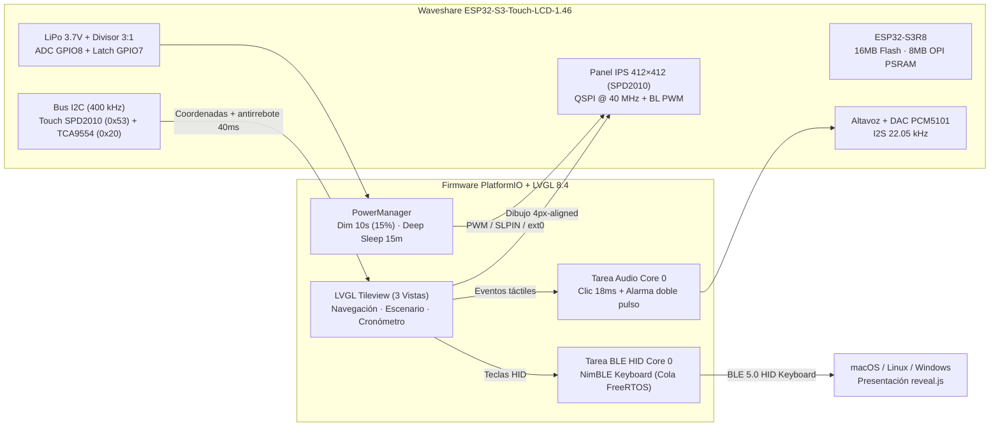

# Kairos-remote

Controlador táctil **BLE HID** con pantalla circular capacitiva de 1.46 pulgadas (`ESP32-S3`) y temporizador local de escenario para presentaciones **reveal.js**.

Sustituye los pasadores convencionales de dos botones por una superficie táctil circular con navegación 2D completa, atajos de escenario, retroalimentación acústica discreta mediante altavoz integrado, gestión energética con atenuación PWM/Deep Sleep y carcasa ergonómica imprimible en 3D.

---

## Arquitectura del Sistema



---

## Lista de Materiales (BOM)

| Componente | Especificación | Notas |
| :--- | :--- | :--- |
| **Placa base** | **Waveshare ESP32-S3-Touch-LCD-1.46** (compatible 1.46 / 1.46B / 1.46C) | ESP32-S3R8, pantalla IPS circular 412×412 SPD2010, altavoz, ADC batería y carga USB-C |
| **Batería LiPo** | Celda LiPo 3.7V `350–500 mAh` (ej. formato `502535` o `602535`) | Conector **JST MX 1.25 mm** de 2 pines (verificar polaridad antes de conectar) |
| **Carcasa 3D** | Piezas en `hardware/enclosure/` (`kairos_body.stl`, `kairos_back_cover.stl`) | Impresión en PLA+/PETG sin soportes |
| **Tornillería** | 2 × tornillos **M2 × 6 mm** | Opcional para fijar la tapa trasera |
| **Cordón** | Cordón de muñeca (*lanyard*) estándar | Ojal integrado de Ø3.6 mm |

---

## Mapa de Conexiones (GPIO / I2C / TCA9554)

Definido de forma centralizada en [`include/board_pins.h`](include/board_pins.h):

| Subsistema | Señal | Pin / Dirección | Descripción |
| :--- | :--- | :--- | :--- |
| **Pantalla QSPI (SPD2010)** | `PCLK` / `CS` | `GPIO 40` / `GPIO 21` | Reloj QSPI 40 MHz y Chip Select |
| **Pantalla QSPI Datos** | `D0`..`D3` | `GPIO 46, 45, 42, 41` | Bus Quad-SPI (ventanas alineadas a múltiplos de 4 px) |
| **Retroiluminación** | `LCD_BL` | `GPIO 5` | PWM LEDC 5 kHz (100% activo, 15% reposo) |
| **Bus I2C Compartido** | `SDA` / `SCL` | `GPIO 11` / `GPIO 10` | Bus a 400 kHz |
| **Táctil Capacitivo** | `SPD2010` / `INT` | `0x53` / `GPIO 4` | Protocolo HDP 16-bit con antirrebote de soltado (40 ms) |
| **Expansor I/O** | `TCA9554PWR` | `0x20` | `EXIO0`: `TP_RST`, `EXIO1`: `LCD_RST`, `EXIO2`: `SD_CS` |
| **Audio I2S (PCM5101)** | `BCLK` / `WS` / `DOUT` | `GPIO 48` / `38` / `47` | Altavoz integrado |
| **Energía y Botones** | `POWER_HOLD` / `PWR` / `BOOT` | `GPIO 7` / `GPIO 6` / `GPIO 0` | Enclavamiento batería y despertar *Deep Sleep* (`ext0` LOW) |
| **Lectura Batería** | `BAT_ADC` | `GPIO 8` | `ADC1_CH7` con divisor resistivo `200 kΩ / 100 kΩ` (`×3.0`) |

---

## Estructura del Repositorio

```text
kairos-remote/
├── platformio.ini                # Entorno ESP32-S3 (16MB Flash / OPI PSRAM) y tests native
├── partitions_16MB.csv           # Tabla de particiones 16 MB
├── include/
│   ├── board_pins.h              # Mapa centralizado de pines GPIO/I2C/EXIO
│   ├── lv_conf.h                 # Configuración LVGL 8.4 (RGB565 swap, fuentes, widgets)
│   └── lv_mem_psram.h            # Asignador de memoria LVGL en OPI PSRAM
├── src/
│   ├── main.cpp                  # Inicialización de hardware y bucle principal LVGL
│   ├── drivers/                  # tca9554, display_spd2010 (QSPI), touch_spd2010 (I2C)
│   ├── ble/                      # hid_keyboard (NimBLE HID) y hid_keymap
│   ├── audio/                    # haptic_click (I2S PCM5101, clic 18ms + alarma)
│   ├── power/                    # power_manager (ADC LiPo, PWM auto-dim, Deep Sleep)
│   └── ui/                       # ui_manager, screen_nav, screen_stage, screen_timer, nav_math
├── test/test_core_logic/         # Pruebas unitarias Unity en host (pio test -e native)
├── hardware/enclosure/           # Carcasa paramétrica (build123d + OpenSCAD + STL/STEP)
└── examples/revealjs-demo/       # Presentación reveal.js 2D con HUD validador de teclas
```

---

## Compilación, Pruebas y Flasheo (PlatformIO)

### Requisitos
- [PlatformIO Core](https://platformio.org/) (`pio --version` ≥ 6.x)
- Cable USB-C de datos conectado al puerto USB de la placa Waveshare

### Comandos

```bash
# 1. Ejecutar pruebas unitarias de lógica pura en el ordenador
pio test -e native

# 2. Compilar el firmware para Waveshare ESP32-S3-Touch-LCD-1.46
pio run -e waveshare_esp32s3_146

# 3. Flashear por USB-C (si no entra automático, mantén BOOT al conectar/pulsar RESET)
pio run -e waveshare_esp32s3_146 -t upload

# 4. Abrir monitor serie (115200 baudios)
pio device monitor -b 115200
```

---

## Manual de Uso

### Emparejamiento Bluetooth
1. Enciende el dispositivo por USB-C o con el botón físico **PWR** lateral.
2. En tu ordenador (macOS, Linux o Windows), abre Ajustes de Bluetooth y empareja **`Kairos-remote`**.
3. El icono Bluetooth de la barra superior cambiará de gris a azul cian (`#38BDF8`) al conectarse.
4. Desde la barra superior también puedes pulsar el icono de altavoz para activar/desactivar el **silenciado global (mute)** de los clics hápticos.

### Las 3 Pantallas (Deslizamiento horizontal / Swipe)

1. **Pantalla 1 — Navegación Principal**
   - **4 arcos exteriores (90°)**: `Arriba` (`KEY_UP_ARROW`), `Abajo` (`KEY_DOWN_ARROW`), `Izquierda` (`KEY_LEFT_ARROW`), `Derecha` (`KEY_RIGHT_ARROW`).
   - **Botón circular central (`SPACE`)**: Avance lineal de diapositivas y fragmentos.

2. **Pantalla 2 — Control de Escenario (`reveal.js`)**
   - **Sup. Izquierda (`ESC`)**: Modo vista general (*Overview*).
   - **Sup. Derecha (`B`)**: Pantalla en negro (*Blackout*).
   - **Inf. Izquierda (`HOME`)**: Volver a la primera diapositiva.
   - **Inf. Derecha (`F`)**: Alternar pantalla completa (*Fullscreen*).
   - **Centro (`ENTER`)**: Confirmar selección en modo *Overview*.

3. **Pantalla 3 — Cronómetro de Cuenta Atrás**
   - **`+1m` / `+2m` / `+5m`**: Añaden minutos tanto en pausa como con el cronómetro en marcha.
   - **`PLAY / PAUSA`**: Inicia o pausa la cuenta atrás (basada en reloj hardware `esp_timer_get_time()`, sigue corriendo mientras usas las Pantallas 1 y 2).
   - **`STOP / RESET`**: Pulsación corta pausa el cronómetro; **mantener pulsado 1.5 segundos** reinicia a `00:00` para evitar borrados accidentales.
   - **Alertas**: Dígitos en **ámbar** por debajo de `02:00` y **rojo parpadeante + alarma de doble pulso** al llegar a `00:00`.

### Ahorro de Energía
- **Atenuación automática**: Tras **10 segundos** sin interacción táctil, el brillo PWM baja al **15%**, restaurándose al **100%** al tocar la pantalla.
- **Deep Sleep**: Tras **15 minutos** sin actividad táctil ni conexión BLE activa, el panel y la radio entran en sueño profundo; pulsa el botón físico **PWR** para despertar.

---

## Validación con `reveal.js`

Abre [`examples/revealjs-demo/index.html`](examples/revealjs-demo/index.html) en cualquier navegador moderno (con acceso a internet para cargar `reveal.js@5` desde CDN, o sirviendo la carpeta localmente con `python3 -m http.server`). El HUD inferior izquierdo iluminará en verde cada una de las 10 teclas emitidas por **Kairos-remote** conforme las vayas probando.

---

## Carcasa Imprimible en 3D

Consulta [`hardware/enclosure/README.md`](hardware/enclosure/README.md) para instrucciones de impresión sin soportes y regeneración paramétrica de los archivos `.stl` y `.step`.
